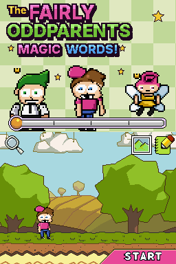
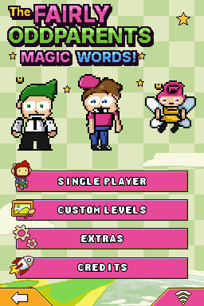
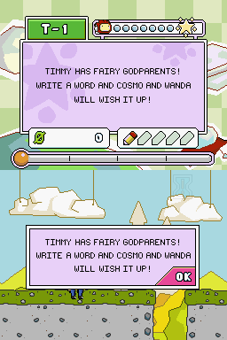
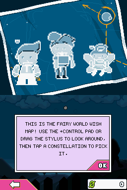
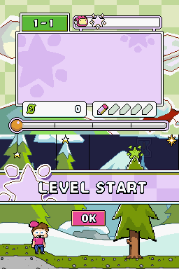
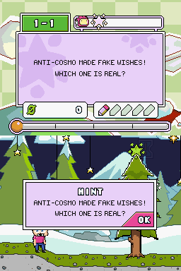

# The Fairly OddParents: Magic Words!

A fan ROM hack of **Super Scribblenauts (USA)** for the Nintendo DS that turns it into a
Fairly OddParents game: you play as Timmy Turner and wish for anything by writing it down.

**[Website & ROM download](https://nyteryzer.github.io/fopgame/#get-the-rom)** · **[Download the latest release](https://github.com/NyteRyzer/fopgame/releases/latest)**

  
  

## What's changed

| Area | Change |
|------|--------|
| Hero | Maxwell is replaced by a hand-drawn **Timmy Turner** puppet (cap, swoosh, buck teeth, pink shirt, jeans). |
| Godparents | **Cosmo** (redrawn over the Fairy Godmother) and **Wanda** (redrawn over the Fairy). |
| Title screen | New *The Fairly OddParents: Magic Words!* logo with Cosmo, Timmy and Wanda on a cream/green gingham. |
| UI | Orange buttons → pink, yellow panels → lavender, lime accents → FOP green, across menus and the HUD. |
| Words | ~85 new dictionary words: COSMO, WANDA, POOF, VICKY, CROCKER, JORGEN, CHESTER, AJ, TOOTIE, FRANCIS, MARK CHANG, CRIMSON CHIN, DA RULES, MAGIC MUFFIN, FAIRY WAND, WISH-O-METER, PEARLY GATE, SUPER TOILET… (see `tools/fop_words.py`). |
| Characters | Vicky, Jorgen Von Strangle, Mark Chang, Vicky's chainsaw recoloured to match the show. |
| Story missions | All 237 level objectives rewritten as Fairly OddParents episodes (Vicky's traps, Crocker's pop quizzes, Jorgen's boot camp, Anti-Fairy attacks, Fairy World, Crimson Chin…), each still asking for the same solution so the in-level hints stay correct. The tutorial now introduces Timmy's godparents. See `tools/fop_story.py`. |
| Wish map | The constellation-map blueprint now shows Timmy, Cosmo and Wanda, with a new intro text. |
| HUD | Pink OK / toolbar buttons and a pink-capped Timmy head next to the level number. |
| Text | Maxwell → Timmy, Starites → Wishes ("WISH GRANTED!"), Ollars → Fairy Bucks, Scribblenauts → Fairly OddParents. |

## Playing it

You need your own dump of **Super Scribblenauts (USA)** (`BH2E`, CRC32 `69F707EA`).

**Easiest: the website.** On the [download page](https://nyteryzer.github.io/fopgame/#get-the-rom),
choose your ROM (`.nds` or `.zip`) and the patched *Fairly OddParents - Magic Words.nds* downloads
right away. It is built in your browser; nothing is uploaded.

**Option A: apply the patch**: download `fop-magic-words.bps` from the
[latest release](https://github.com/NyteRyzer/fopgame/releases/latest) (also in `patches/`), open it with any BPS patcher
(Floating IPS, or the web-based *ROM Patcher JS*) and select your ROM.

**Option B: build it yourself**

```sh
pip install ndspy pillow
python3 tools/build.py "Super Scribblenauts (USA).nds" "Fairly OddParents - Magic Words.nds"
```

No game data is stored in this repository; the build reads everything from your ROM.

## Making a release

Run the *Release* workflow from the Actions tab (enter a tag such as `v1.1`), or push a version tag; it publishes
a GitHub release with the patch and `docs/RELEASE_NOTES.md`. The website is `docs/index.html`
(Settings → Pages → Deploy from branch `main`, folder `/docs`).

## How it works

See [`docs/FORMATS.md`](docs/FORMATS.md) for the reverse-engineered file formats. In short:

- All game data lives in `1p` (LZ10-compressed entries) indexed by `1i`. **Every compressed entry
  must end with a `0x01` marker byte** or the loader silently skips it.
- `tools/build.py` loads the ROM, applies each patch module, recompresses changed entries with an
  optimal-parse LZ10 encoder (`tools/lz10.py`) and writes the new ROM.

| Module | Purpose |
|--------|---------|
| `fop_words.py` / `dictparse.py` | New dictionary words as synonyms of existing objects |
| `fop_text.py` / `script_text.py` | Text rewrite rules for level scripts and string tables |
| `fop_story.py` | Story-mission objectives and tutorial lines |
| `timmy_art.py` / `timmy_build.py` | Timmy's hand-drawn puppet parts |
| `fairies.py` | Cosmo and Wanda |
| `fop_assets.py` / `recolor.py` | Palette recolours of other characters and items |
| `titlegen.py` / `poses.py` | Title screen logo and character art |
| `fop_ui.py` | UI palette reskin |
| `bps.py` | Patch creation / verification |

`tools/research/` holds the emulator harness (py-desmume) and format-exploration scripts used to
find all of this; they are not needed to build.

## Known gaps

- The avatar line-up on the profile screen and some avatar art still show the original cast.
- Level backgrounds (bedroom, classroom, suburbs, Fairy World) are the original scenery.
- Most new words spawn the original-looking object; only the characters listed above are redrawn.

## Credits

Fan project, not affiliated with Nickelodeon, Warner Bros. or 5th Cell. *The Fairly OddParents*
is © Nickelodeon; *Super Scribblenauts* is © Warner Bros. Entertainment / 5th Cell.
Distribute the patch, never the ROM.
